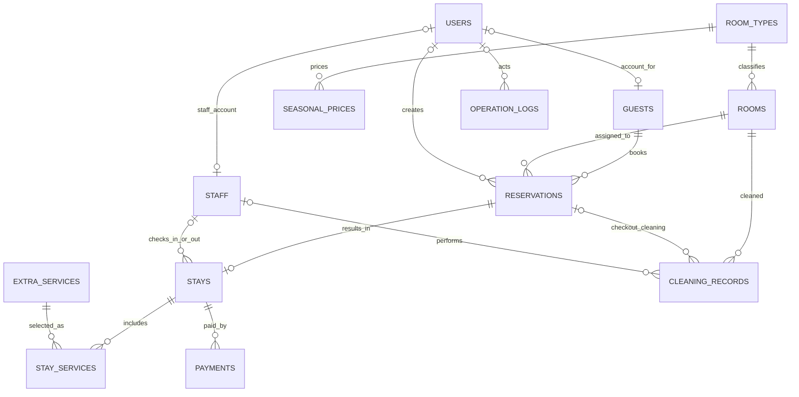

# Otel Yönetim Sistemi — Veritabanı

Veritabanı katmanı MySQL 8.0 ve InnoDB için hazırlanmıştır. Tarih aralıkları
`[giriş, çıkış)` olarak yorumlanır: bir misafirin çıkış günü aynı odada yeni bir
rezervasyonun giriş günü olabilir. Tablolar 3NF'e uygun olacak şekilde
normalleştirilmiştir; konaklama hizmetinin birim fiyatı, hizmet fiyatı daha sonra
değişse bile fatura geçmişini korumak için `stay_services.unit_price` alanında
işlem anında saklanır.

## Dosyalar

- `sql/01_schema.sql`: 13 ilişkisel tablo, anahtarlar, kısıtlar ve indeksler.
- `sql/02_routines.sql`: rezervasyon/sezon fiyatı kontrolleri, işlem logları,
  check-in/check-out tetikleyicileri; üç saklı yordam ve iki görünüm.
- `sql/03_seed.sql`: 20 oda, 50 misafir, 200 çakışmayan geçmiş rezervasyon,
  konaklama, ödeme ve örnek hizmet/personel kayıtları.
- `sql/04_index_benchmark.sql`: rezervasyon tarih araması için indeksli ve
  indekssiz `EXPLAIN ANALYZE` karşılaştırması.

## Kurulum

MySQL 8.0 sunucusunda, dosyaları sırasıyla bir MySQL istemcisiyle çalıştırın.
`03_seed.sql` bir kez, boş ve yeni oluşturulmuş şemada çalıştırılmalıdır:

```powershell
mysql -u root -p < sql\01_schema.sql
mysql -u root -p hotel_management < sql\02_routines.sql
mysql -u root -p hotel_management < sql\03_seed.sql
```

Bu komutları PowerShell'de çalıştırmak için her satırın başına `cmd /c` ekleyin
(ör. `cmd /c "mysql -u root -p < sql\01_schema.sql"`). Dosyaları MySQL Workbench'te
aynı sırayla açıp çalıştırmak da mümkündür. Veritabanı kullanıcısının veritabanı,
tablo, tetikleyici, yordam ve görünüm oluşturma yetkileri olmalıdır.

`.env.example` dosyasını `.env` olarak kopyalayıp `SECRET_KEY` ile `DB_USER`,
`DB_PASSWORD`, `DB_HOST`, `DB_PORT` (isteğe bağlı) ve `DB_NAME=hotel_management`
değerlerini doldurun. `.env` Git'e eklenmez. Alternatif olarak tüm bağlantıyı
`DATABASE_URL` ile sağlayabilirsiniz. SQLAlchemy bağlantı adresi oluşturulurken
parola URL biçiminde güvenli şekilde kaçışlanır.

Ardından Flask uygulamasını başlatın:

```powershell
.\venv\Scripts\python.exe main.py
```

`GET /api/health`, veritabanı bağlantısını `SELECT 1` ile denetler. Uygulama
şemayı otomatik oluşturmaz: MySQL'e özgü tetikleyiciler ve yordamlar SQL dosyalarıyla
kurulmalıdır.

SQLite bellek veritabanıyla Flask sağlık uç noktası testi:

```powershell
.\venv\Scripts\python.exe -m unittest discover -s tests
```

## Veritabanı kuralları ve API'den kullanım

- Çakışan oda rezervasyonu, hem `INSERT` hem `UPDATE` öncesinde veritabanında
  reddedilir. Oda satırı kilitlenir ve mevcut rezervasyonlar kilitlemeli okuma ile
  denetlenir; eşzamanlı denemelerde çakışan kayıt kabul edilmez. İptal edilmiş
  rezervasyonlar çakışma hesabına dahil edilmez.
- Sezon fiyatı tarihleri `[valid_from, valid_to)` aralığıdır; bir oda tipi için
  sezon aralıklarının çakışması tetikleyicide engellenir. Her gece için fiyat
  bulunamazsa toplam prosedürü açık hata verir.
- Rezervasyonun `confirmed` durumundan `checked_in` durumuna geçmesi konaklama
  kaydı oluşturur ve odayı `occupied` yapar. `sp_check_out` tek transaction
  içinde konaklamayı hesaplar, ödeme kaydı oluşturur ve rezervasyonu kapatır;
  bir adım hata verirse tüm değişiklikler geri alınır. Check-out tetikleyicisi odayı
  `cleaning` yapar ve temizlik kaydı açar.
- Temizlik kaydı `completed` yapıldığında tetikleyici tamamlanma zamanını kaydeder
  ve oda `cleaning` durumundaysa yeniden `available` durumuna alır.
- Rezervasyon ve ödeme ekleme/değişiklikleri `operation_logs` tablosuna yazılır.
- Boş oda aramak için `CALL sp_find_available_rooms('2026-11-01', '2026-11-03', NULL);`
- Konaklama toplamı almak için `CALL sp_calculate_stay_total(1, @total); SELECT @total;`
- Aylık rapor almak için `CALL sp_monthly_report(2026, 10);`
- Check-out ve aynı transaction içinde ödeme kaydetmek için
  `CALL sp_check_out(1, 'card', @total); SELECT @total;`
- Günün giriş/çıkışları `SELECT * FROM vw_today_arrivals_departures;` ile,
  oda durumu ve son tamamlanan temizlik `SELECT * FROM vw_room_status_and_last_cleaning;`
  ile okunur.

`sp_check_out` ödemeyi kayıtlı/başarılı kabul eder; gerçek kart tahsilatı için
ödeme sağlayıcısının yanıtı alınmadan bu prosedür çağrılmamalıdır. Check-in işlemi
uygulamanın yetkilendirilmiş resepsiyon akışından rezervasyon durumunun
`checked_in` yapılmasıyla gerçekleştirilir.

## Tablo ilişkileri

`room_types` 1-N `rooms`; `room_types` 1-N `seasonal_prices`; `guests` 1-N
`reservations`; `rooms` 1-N `reservations`; `reservations` 1-0/1 `stays`;
`stays` 1-N `stay_services` ve `payments`; `extra_services` 1-N `stay_services`;
`staff` işlemleri konaklama ve temizlik kayıtlarına bağlanır. `users`, misafir
hesabını isteğe bağlı olarak bir `guest` kaydına ve personel hesabını `staff`
kaydına bağlar. `operation_logs` denetim geçmişini tutar.



## İndeks karşılaştırması

`sql/04_index_benchmark.sql` sorgusunu MySQL 8.0.18 veya üzerinde çalıştırıp
çıktıdaki gerçek süreleri rapora kaydedin. İki `EXPLAIN ANALYZE` sorgusu aynı
rezervasyon aramasını sırasıyla indeks kullanmaya zorlar ve indeksi devre dışı
bırakır. Veriler küçükken fark ölçüm gürültüsüne yakın olabilir; gerçek ölçümü
raporlarken 200 örnek rezervasyonla alınan sonucu ve kullanılan MySQL sürümünü
belirtin. Misafir e-postası benzersiz indeksle, oda numarası da benzersiz indeksle
desteklenir.
